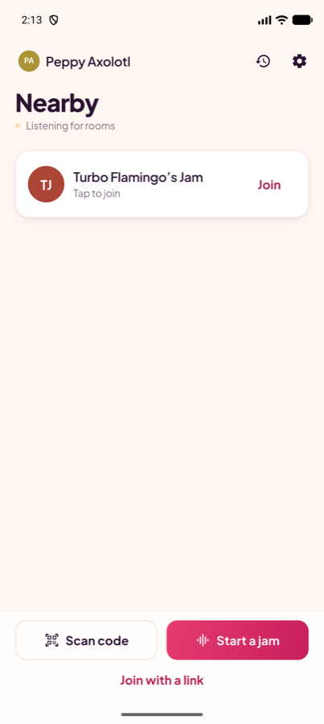
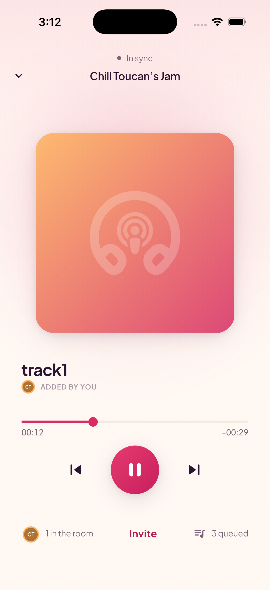
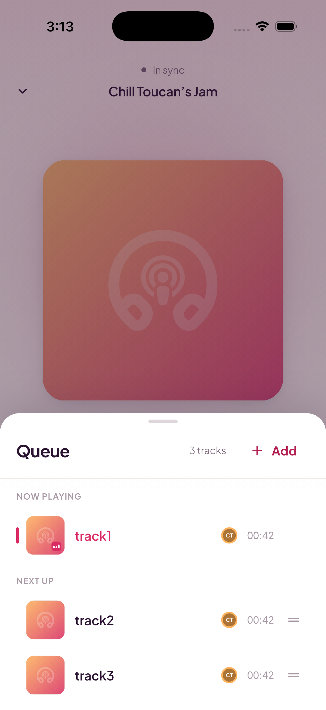
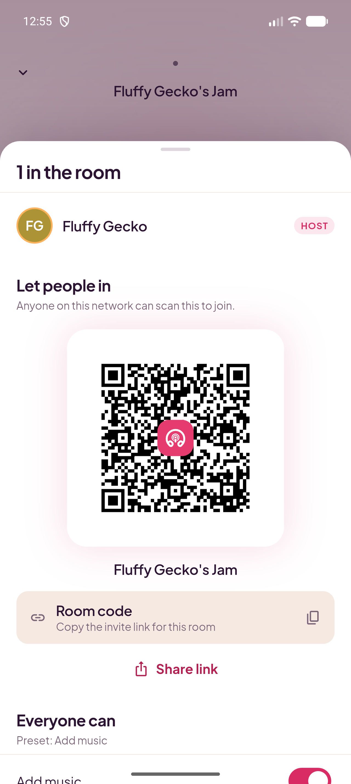

<p align="center">
  
</p>

<h1 align="center">LocalJam</h1>

<p align="center">
  <em>Listen together, in sync, over local Wi-Fi. No internet, no accounts.</em>
</p>

One person hosts a jam and picks the songs; everyone nearby joins over the
same Wi-Fi or the host's hotspot and hears the same thing at the same moment,
in their own headphones. No servers, no sign-in, nothing leaves the room.
Think Spotify Jam, but local, in the spirit of LocalSend.

**Status: 1.0.0, Android first.** The Android app is heading to Google Play.
iOS and macOS run from source and come next; Windows and Linux build but are
not runtime-verified. See [Platforms](#platforms) and
[Known limitations](#known-limitations) before you rely on it.

<p align="center">
  
  
  
  
</p>

<p align="center"><sub>Design captures from simulators and emulators. Store screenshots from real phones are still to come.</sub></p>

## What it does

- **Rooms.** Host a named jam; guests join from "Nearby" (mDNS discovery), by
  scanning a QR code, or with a link shared any way you like. Every device
  gets a friendly random name ("Silky Puffin") you can change.
- **Join from a browser.** The host phone serves a small listener page on the
  local network, so a friend without the app scans the QR and listens in
  their browser. Browser guests cannot add songs or host.
- **A shared queue.** Anyone allowed can add songs (file picker, or the phone's
  music library on Android, or browse the host's library), reorder and skip.
  Every song shows who added it.
- **Permissions that read like a decision.** Three room presets, **Open**,
  **Jam** and **Listen-only**, plus co-hosts, per-person overrides and kick.
- **Background playback** with lock-screen and notification controls, gated by
  the same permissions as the in-app ones.
- **Jam history**, kept on the device: what played, who added it, who was
  there.
- **Private by design.** No accounts, no analytics, no ads, no server. See
  [`PRIVACY.md`](PRIVACY.md).

## How it works

The host phone runs a small server on the local network: a WebSocket for
control and HTTP for the audio files. Guests fetch each song ahead of time
and synchronise their clocks with the host's (NTP-style). The host then
broadcasts an **anchor**, "position P at session time T"; every device
computes `position(t) = P + (t − T) × rate` and starts audio natively at that
exact instant. Small drift is corrected with inaudible ±0.5 % speed changes,
never audible jumps.

The wire protocol is specified in [`PROTOCOL.md`](PROTOCOL.md), which is the
place to start if you want to understand or extend the engine.

## Platforms

| Platform | Status |
| --- | --- |
| **Android** | 1.0.0 target. Verified on an API 36 emulator: host and guest, MediaStore library, foreground-service media card, background playback, process-death recovery. Physical-device verification is in progress ([`DEVICE_TESTING.md`](DEVICE_TESTING.md)). |
| **iOS** | Runs from source. Verified on simulators (host + guest, mDNS join, background audio, media card). Not yet on the App Store. |
| **macOS** | Runs from source; joined a live session at −0.4 ms measured drift. |
| **Browser (guest only)** | Built, checked in headless Chrome against a CLI host. Not yet tried on real phones. Safari cannot play Ogg Vorbis/Opus. |
| **Linux** | Builds (Ubuntu 24.04 arm64 container). Runtime audio not exercised on hardware. |
| **Windows** | Never compiled. The first task on a Windows machine is `flutter build windows`. |

iOS, Android and macOS decode everything the OS does (mp3, m4a/AAC, flac,
wav, ogg). Windows and Linux decode mp3, flac, wav and ogg; m4a/AAC returns
`unsupported_format` there.

## Known limitations

Honest list, for 1.0.0:

- **Sync has been measured on simulators, emulators and a macOS desktop, not
  yet across a matrix of physical phones.** On a shared machine clock the
  engine holds drift within ±5–10 ms; real Wi-Fi with independent clocks is
  exactly what [`DEVICE_TESTING.md`](DEVICE_TESTING.md) still has to confirm.
  A non-accelerated Android emulator has been seen to fall out of sync.
- **Bluetooth latency** is compensated only as far as the OS reports it; a
  "Nudge sync" control fixes the rest by hand.
- **Same network required.** Guests must be on the host's Wi-Fi or hotspot.
  Guest Wi-Fi and many office or public networks isolate devices from each
  other, and then nobody can join.
- **Plain HTTP on the LAN, by design.** A random 128-bit session token gates
  every request, but traffic is not encrypted. Use networks you trust. See
  [Security model](#security-model).
- **Browser guests** must keep the tab open and in front; a backgrounded or
  locked tab may stop playing.
- **One host per room.** If the host leaves, the jam ends.

## Install

- **Android:** Google Play listing coming with 1.0.0. Until then, build from
  source (below).
- **iOS / macOS:** build from source with your own Apple developer team.

## Build from source

You need Flutter **3.50.0** (CI pins 3.50.0 / Dart 3.14.0) and, for Android,
the Android SDK with API 37 platform and NDK 28.2 (Flutter installs what it is
missing).

```sh
git clone https://github.com/bimsina/localjam.git
cd localjam

# Optional: the browser listener page that hosts serve to guests without the
# app. Without it the app still builds, and rooms serve an "install the app"
# page instead.
tool/build_web_guest.sh

cd apps/localjam_app
flutter run                 # debug, on whatever device is attached
flutter build apk --debug   # an installable debug APK
```

A **release** build needs a signing key and fails without one. To try a
release build locally with the debug key:

```sh
LOCALJAM_ALLOW_DEBUG_SIGNING=1 flutter build apk --release
```

Signing for Play, the permission list and the store checklist are in
[`docs/release/ANDROID_RELEASE.md`](docs/release/ANDROID_RELEASE.md).

Two devices on the same network are the point: host on one, join on the
other. Without a second phone, the headless CLI can stand in as a host or a
guest:

```sh
cd apps/localjam_cli
dart run bin/localjam.dart host <audio files...>          # prints a join link
dart run bin/localjam.dart join "<join link>" --skew-ppm 5000
```

### Tests

```sh
cd packages/localjam_core   && dart test
cd packages/localjam_net    && dart test
cd packages/localjam_client && flutter test
cd packages/localjam_audio  && flutter test
cd apps/localjam_cli        && dart test
cd apps/localjam_app        && flutter test
cd apps/localjam_web        && flutter test
```

All of them run offline in seconds, with no device attached.

### Repository layout

```
PROTOCOL.md            the wire protocol (start here)
packages/
  localjam_core        pure Dart: messages, codec, clock sync, anchors, permissions
  localjam_net         transport: host server (WebSocket + HTTP), guest client, reconnect
  localjam_audio       Flutter plugin: sample-accurate native playback + OS media session
  localjam_client      the embeddable engine the apps depend on
  third_party/         vendored forks, each with its LICENSE and PATCHES.md
                       (bonsoir_darwin: mDNS registration moved off the
                       iOS main thread, which upstream can wedge)
apps/
  localjam_app         the Flutter app (Android, iOS, macOS, Windows, Linux)
  localjam_web         the browser listener page a host serves (guest only)
  localjam_cli         headless host/guest for testing
docs/
  design/              design specs
  release/             store and release docs
```

More on the app itself (icons, splash screen, per-platform notes) is in
[`apps/localjam_app/README.md`](apps/localjam_app/README.md).

## Security model

LocalJam is built for the threat model of a living room, not a coffee shop.
In full: [`PROTOCOL.md` §9](PROTOCOL.md); to report a vulnerability, see
[`SECURITY.md`](SECURITY.md).

- **A token gates everything.** A 128-bit random session token, carried in the
  QR code and join link, guards both the control and media planes, compared
  in constant time.
- **Discoverable means invited.** A host that leaves nearby discovery on is
  announcing the room to its network segment. Turn it off and only the QR
  code or link gets people in.
- **LAN only.** The host refuses requests from non-private addresses with a
  403, and caps peers, queue length, frame and upload sizes.
- **Plaintext, by decision.** Browsers would show a certificate warning for a
  self-signed certificate on a LAN IP, with nothing they could pin. TLS stays a
  possible hardening for hostile networks.

## Contributing

Bug reports, real-device test results (especially physical Android phones,
Windows and Linux) and patches are welcome. Start with
[`CONTRIBUTING.md`](CONTRIBUTING.md) and [`PROTOCOL.md`](PROTOCOL.md); changes
are tracked in [`CHANGELOG.md`](CHANGELOG.md).

## License

[MIT](LICENSE) © Bibek Timsina.

Vendored and bundled third-party code keeps its own licence:
`packages/third_party/bonsoir_darwin` (MIT, Skyost),
`packages/localjam_audio/src/third_party/` (miniaudio, dr_libs, stb_vorbis:
public domain or MIT-0/MIT, see its `LICENSES.md`), the Manrope font
(SIL OFL 1.1, `apps/localjam_app/assets/fonts/OFL.txt`) and the Noto Sans
Devanagari font bundled in the web guest (SIL OFL 1.1,
`apps/localjam_web/assets/fonts/NotoSansDevanagari-OFL.txt`). The app lists
every dependency's licence under Settings → Licenses.

The Android build also bundles Google's proprietary ML Kit barcode-scanning
library (through `mobile_scanner`) for QR scanning, under Google's own terms.

Only share music you have the right to share.
