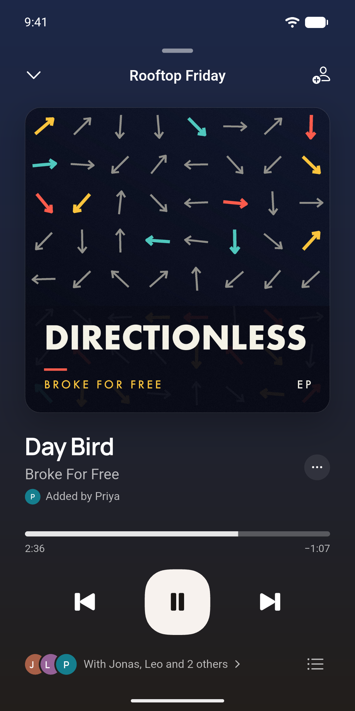
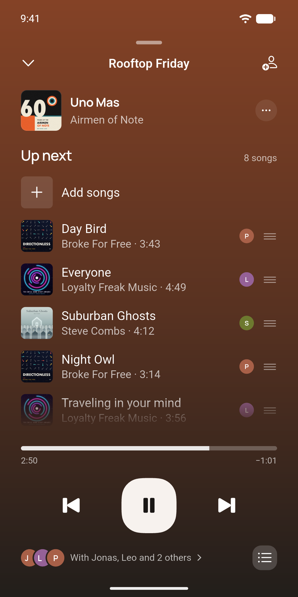
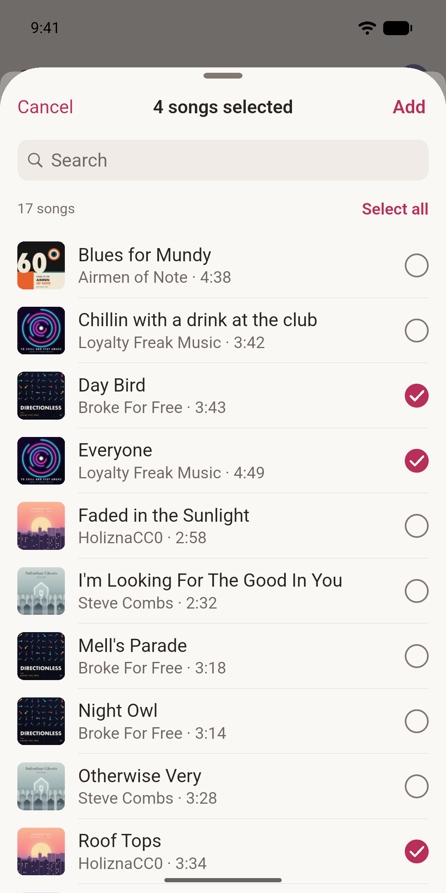
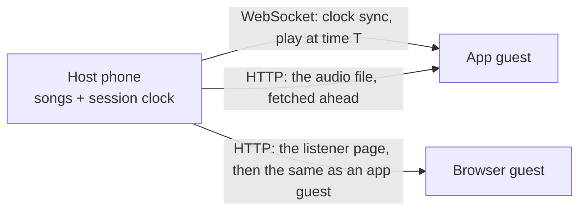

<p align="center">
  
</p>

<h1 align="center">LocalJam</h1>

<p align="center">
  Listen together, in sync, over local Wi-Fi. No internet, no accounts.
</p>

<p align="center">
  <a href="https://github.com/bimsina/localjam/actions/workflows/ci.yml"></a>
  <a href="https://github.com/bimsina/localjam/releases/latest"></a>
  <a href="LICENSE"></a>
  <a href="#platforms"></a>
</p>

One phone starts a jam and plays music from its own files. Everyone on the
same Wi-Fi or hotspot hears the same song at the same moment, on their own
device: in the LocalJam app, or in any browser through a page the host
serves. No internet, no accounts, no servers. Nothing leaves the room.

<table align="center">
  <tr>
    <td></td>
    <td></td>
    <td></td>
    <td></td>
    <td></td>
  </tr>
</table>

<p align="center"><sub>Android captures. The music shown is freely licensed; see <a href="#licence-and-credits">credits</a>.</sub></p>

## About

LocalJam is for the moment when a few people want to hear the same thing:
a car, a kitchen, a trip, a room of headphones. One person hosts and picks
the songs. Everyone else joins from **Nearby**, a **QR code** or a **link**.
A friend without the app scans the QR and listens in the browser.

It is open source, Android first, and honest about what it has and has not
been tested on. Version **1.0.0** is not released yet; see
[Platforms](#platforms).

## How it works



The host phone runs a small server on the local network. Guests download each
song ahead of time and synchronise their clocks with the host's. The host then
says "position P at time T", and every device starts its own audio at that
instant. Small drift is corrected with inaudible speed changes, not jumps.

The wire protocol is specified in [`PROTOCOL.md`](PROTOCOL.md).

## Download

| Platform | Get it | Notes |
| --- | --- | --- |
| **Android** | [](https://play.google.com/store/apps/details?id=np.com.bibektimsina.localjam) <br> [APK on GitHub Releases](https://github.com/bimsina/localjam/releases/latest) | The main release. |
| **macOS** | [GitHub Releases](https://github.com/bimsina/localjam/releases/latest) (`.zip`) | Preview. Not notarized: the first time, right-click the app and choose **Open**. |
| **Linux** (x64) | [GitHub Releases](https://github.com/bimsina/localjam/releases/latest) (`.tar.gz`) | Experimental. Builds; audio not yet tried on real hardware. Needs GTK 3. |
| **Windows** (x64) | [GitHub Releases](https://github.com/bimsina/localjam/releases/latest) (`.zip`) | Experimental. Built by the release workflow; nobody has run it yet. |
| **iOS** | [Build from source](#building-from-source) | Needs your own Apple developer team. Verified on simulators. Not on the App Store yet. |
| **Any browser** | Scan the host's QR code | Listen only. No install. |

- **The GitHub APK and the Google Play build are signed with different keys**
  and cannot update each other. Uninstall one before installing the other.
- **Windows and Linux play mp3, flac, wav and ogg only.** m4a/AAC is not
  supported there yet. Android, iOS and macOS play whatever the OS decodes.
- A desktop build that fails is left out of a release rather than holding
  Android back, so a release may not carry every desktop file. Each release
  lists its files in `SHA256SUMS.txt`.

## Features

- **Rooms.** Host a named jam. Guests join from Nearby (mDNS), a QR code or a
  link. Every device gets a friendly random name ("Silky Puffin") you can
  change.
- **Join from a browser.** The host serves a small listener page on the local
  network. Browser guests listen in sync but cannot add songs or host.
- **A shared queue.** Add songs from the file picker, the phone's music
  library (Android) or the host's own library. Reorder and skip. Every song
  shows who added it.
- **Permissions that read like a decision.** Three room presets, **Open**,
  **Jam** and **Listen-only**, plus co-hosts, per-person overrides and kick.
- **Background playback** with lock-screen and notification controls, gated
  by the same permissions.
- **Sync nudge.** A manual control for the latency the OS does not report,
  such as some Bluetooth headphones.
- **Jam history** on the device: what played, who added it, who was there.
  Host it again in one tap.
- **Light and dark** themes.
- **Private by design.** No accounts, no analytics, no ads, no server.

## Platforms

| Platform | Status |
| --- | --- |
| **Android** | 1.0.0 target. Verified on an API 36 emulator: host and guest, the phone's music library, the media notification, background playback, process-death recovery. Physical-phone verification is in progress. |
| **iOS** | Runs from source. Verified on simulators: host and guest, Nearby join, background audio, media controls. |
| **macOS** | Runs from source. Joined a live jam at −0.4 ms measured drift. |
| **Browser** (guest only) | Built and checked in headless Chrome. Not yet tried on real phones. Safari cannot play Ogg Vorbis/Opus. |
| **Linux** | Builds (Ubuntu 24.04 arm64 container). Audio not exercised on real hardware. |
| **Windows** | Never compiled with MSVC or run. The audio plugin's native code compiles with MinGW against the Flutter Windows headers. |

**Sync has been measured on simulators, emulators and a macOS desktop, not
yet across a set of physical phones.** On a shared machine clock the engine
holds drift within about ±5–10 ms; a non-accelerated Android emulator has
been seen to fall out of sync. Real Wi-Fi with independent clocks is what
[`DEVICE_TESTING.md`](DEVICE_TESTING.md) still has to confirm, and test
reports from real devices are the most useful contribution right now.

Other known limits:

- **One host per room.** If the host leaves, the jam ends.
- **Browser guests** must keep the tab open and in front. A backgrounded or
  locked tab may stop playing.
- **Bluetooth latency** is compensated only as far as the OS reports it. The
  sync nudge covers the rest by hand.

## Setup and troubleshooting

**Everyone must be on the same network.** Same Wi-Fi, or the host's hotspot.

| Problem | Try |
| --- | --- |
| The jam does not show under Nearby | Join with the QR code or link instead. Nearby uses mDNS, which hotspots, guest Wi-Fi and many office networks block. |
| Nobody can connect at all | The network probably isolates devices from each other ("AP isolation", "client isolation", common on guest and public Wi-Fi). Use a home network or a phone hotspot. |
| Using a hotspot | One phone turns on its hotspot and the others join it. Then host on the hotspot phone and share the QR code. |
| Hosting on a desktop | Allow LocalJam through the firewall for incoming connections on private networks. |
| A guest drifts or sounds late | Use the sync nudge. On Bluetooth, some delay is expected. |

**Ports.** The host listens on **one TCP port**, which the OS picks fresh each
time a jam starts. It carries the WebSocket, the audio and the browser page.
Nearby discovery uses **mDNS on UDP 5353**. Because the TCP port changes,
allow the app in your firewall rather than a fixed port.

## Privacy and security

LocalJam collects no data and has no server; everything stays on your devices
and your local network ([`PRIVACY.md`](PRIVACY.md)). Traffic on the network is
plain HTTP gated by a random 128-bit session token, so use networks you trust,
and know that **a room left discoverable can be joined by anyone on the same
network**: turn Nearby off to admit people only by QR code or link. The full
threat model is in [`PROTOCOL.md` §9](PROTOCOL.md#9-security-model-honest-guest-hostile-network-lite);
report vulnerabilities privately as described in [`SECURITY.md`](SECURITY.md).

## Building from source

You need **Flutter 3.50.0** (Dart 3.14.0), which CI pins. Older Flutter
releases do not build it: the app uses the `material_ui` and `cupertino_ui`
packages and the Android toolchain 3.50 requires.
For Android you also need the Android SDK (API 37 platform, NDK 28.2; Flutter
installs what is missing). iOS and macOS need Xcode. Linux needs
`clang cmake ninja-build pkg-config libgtk-3-dev`.

```sh
git clone https://github.com/bimsina/localjam.git
cd localjam

# Optional: the browser listener page that hosts serve to guests without the
# app (about 17 MB, never committed). Without it the app still builds, and
# rooms serve an "install the app" page instead.
tool/build_web_guest.sh

cd apps/localjam_app
flutter run                    # debug, on whatever device is attached
flutter build apk --debug      # an installable debug APK
flutter build macos            # or: ios --simulator --no-codesign, linux, windows
```

A **release** Android build needs a signing key and fails without one. To try
a release build locally with the debug key:

```sh
LOCALJAM_ALLOW_DEBUG_SIGNING=1 flutter build apk --release
```

Per-platform notes (iOS Files folder, macOS entitlements, the patched
`bonsoir_darwin` override, icons and splash) are in
[`apps/localjam_app/README.md`](apps/localjam_app/README.md).

**No second phone?** The headless CLI can stand in as a host or a guest:

```sh
cd apps/localjam_cli
dart run bin/localjam.dart host <audio files...>          # prints a join link
dart run bin/localjam.dart join "<join link>" --skew-ppm 5000
```

### Tests

```sh
cd packages/localjam_core   && dart test
cd packages/localjam_net    && dart test
cd packages/localjam_client && flutter test
cd packages/localjam_audio  && flutter test
cd apps/localjam_cli        && dart test
cd apps/localjam_app        && flutter test
cd apps/localjam_web        && flutter test
```

All of them run offline in seconds, with no device attached. What only real
hardware can prove is in [`DEVICE_TESTING.md`](DEVICE_TESTING.md).

## Repository layout

```
PROTOCOL.md            the wire protocol (start here for the engine)
packages/
  localjam_core        pure Dart: messages, codec, clock sync, anchors, permissions
  localjam_net         transport: host server (WebSocket + HTTP), guest client, mDNS
  localjam_audio       Flutter plugin: sample-accurate native playback + OS media session
  localjam_client      the embeddable engine the apps depend on
  third_party/         vendored forks, each with its LICENSE and PATCHES.md
apps/
  localjam_app         the Flutter app (Android, iOS, macOS, Linux, Windows)
  localjam_web         the browser listener page a host serves (guest only)
  localjam_cli         headless host/guest for testing
tool/                  build_web_guest.sh
docs/
  design/              design specs (UI, web guest, library catalog)
  release/             Android release, Play listing, Data safety
```

Dependencies point one way: `core → net → client`, with `audio` beside them,
and the app depends on `localjam_client` only. Each package has its own
README: [core](packages/localjam_core/README.md),
[net](packages/localjam_net/README.md),
[audio](packages/localjam_audio/README.md),
[client](packages/localjam_client/README.md),
[web](apps/localjam_web/README.md).

## Releasing

Push a tag `vX.Y.Z` that matches `version:` in
`apps/localjam_app/pubspec.yaml`.
[`.github/workflows/release.yml`](.github/workflows/release.yml) then builds
the signed Android APK and App Bundle plus macOS, Linux and Windows, and
attaches them to a **draft** GitHub release, which is published by hand. A
desktop build that fails is left out rather than blocking Android. Signing,
Play upload and the store checklist are in
[`docs/release/ANDROID_RELEASE.md`](docs/release/ANDROID_RELEASE.md).

## Contributing

Bug reports, real-device test results (especially physical phones, Windows
and Linux) and patches are welcome. Start with
[`CONTRIBUTING.md`](CONTRIBUTING.md); changes are tracked in
[`CHANGELOG.md`](CHANGELOG.md).

## Licence and credits

[MIT](LICENSE) © Bibek Timsina.

Vendored and bundled third-party code keeps its own licence:
`packages/third_party/bonsoir_darwin` (MIT, Skyost; mDNS registration moved
off the iOS main thread),
`packages/localjam_audio/src/third_party/` (miniaudio, dr_libs, stb_vorbis:
public domain or MIT-0/MIT, see its `LICENSES.md`), the Manrope font
(SIL OFL 1.1, `apps/localjam_app/assets/fonts/OFL.txt`) and the Noto Sans
Devanagari font bundled in the web guest (SIL OFL 1.1,
`apps/localjam_web/assets/fonts/NotoSansDevanagari-OFL.txt`). The app lists
every dependency's licence under Settings → Licenses.

The Android build also bundles Google's proprietary ML Kit barcode-scanning
library (through `mobile_scanner`) for QR scanning, under Google's own terms.
It runs on the device, and its usage-statistics upload is disabled.

Only share music you have the right to share.

<details>
<summary>Music in the screenshots</summary>

The store screenshots and launch video use freely licensed music. Cover art is
original artwork made for the demo.

- HoliznaCC0 — *Roof Tops*, *Summer Felt Longer Then*, *Faded in the Sunlight* (Summer Air (Lo-fi), 2026) — [CC0 1.0](https://creativecommons.org/publicdomain/zero/1.0/) — [1](https://freemusicarchive.org/music/holiznacc0/summer-air-lo-fi/roof-tops/), [2](https://freemusicarchive.org/music/holiznacc0/summer-air-lo-fi/summer-felt-longer-then/), [3](https://freemusicarchive.org/music/holiznacc0/summer-air-lo-fi/faded-in-the-sunlight/)
- Broke For Free — *Night Owl*, *Day Bird*, *Mell's Parade* (Directionless EP, 2011) — [CC BY 3.0](https://creativecommons.org/licenses/by/3.0/) — [1](https://freemusicarchive.org/music/Broke_For_Free/Directionless_EP/Broke_For_Free_-_Directionless_EP_-_01_Night_Owl/), [2](https://freemusicarchive.org/music/Broke_For_Free/Directionless_EP/Broke_For_Free_-_Directionless_EP_-_03_Day_Bird/), [3](https://freemusicarchive.org/music/Broke_For_Free/Directionless_EP/Broke_For_Free_-_Directionless_EP_-_05_Mells_Parade/)
- Loyalty Freak Music — *Everyone*, *Chillin with a drink at the club*, *Traveling in your mind* (TO CHILL AND STAY AWAKE, 2017) — [CC0 1.0](https://creativecommons.org/publicdomain/zero/1.0/) — [1](https://freemusicarchive.org/music/Loyalty_Freak_Music/TO_CHILL_AND_STAY_AWAKE/Loyalty_Freak_Music_-_TO_CHILL_AND_STAY_AWAKE_-_02_Everyone/), [2](https://freemusicarchive.org/music/Loyalty_Freak_Music/TO_CHILL_AND_STAY_AWAKE/Loyalty_Freak_Music_-_TO_CHILL_AND_STAY_AWAKE_-_03_Chillin_with_a_drink_at_the_club/), [3](https://freemusicarchive.org/music/Loyalty_Freak_Music/TO_CHILL_AND_STAY_AWAKE/Loyalty_Freak_Music_-_TO_CHILL_AND_STAY_AWAKE_-_05_Traveling_in_your_mind/)
- Steve Combs — *Suburban Ghosts*, *I'm Looking For The Good In You*, *Where Else But Here?*, *Otherwise Very* (Suburban Ghosts, 2016) — [CC BY 4.0](https://creativecommons.org/licenses/by/4.0/) — [1](https://freemusicarchive.org/music/Steve_Combs/Suburban_Ghosts/Steve_Combs_-_Suburban_Ghosts_-_01_Suburban_Ghosts/), [2](https://freemusicarchive.org/music/Steve_Combs/Suburban_Ghosts/Steve_Combs_-_Suburban_Ghosts_-_02_Im_Looking_For_The_Good_In_You/), [3](https://freemusicarchive.org/music/Steve_Combs/Suburban_Ghosts/Steve_Combs_-_Suburban_Ghosts_-_04_Where_Else_But_Here-/), [4](https://freemusicarchive.org/music/Steve_Combs/Suburban_Ghosts/Steve_Combs_-_Suburban_Ghosts_-_06_Otherwise_Very/)
- Airmen of Note (U.S. Air Force Band) — *さくら (Sakura)*, *아리랑 (Arirang)* (Global Reach, 2018); *Uno Mas*, *Blues for Mundy* (60 Years of the Airmen of Note, 2011) — [Public domain (US federal government work)](https://commons.wikimedia.org/wiki/Template:PD-USGov-Military-Air_Force) — [1](https://commons.wikimedia.org/wiki/File:Sakura_-_Airmen_of_Note_-_United_States_Air_Force_Band.mp3), [2](https://commons.wikimedia.org/wiki/File:Arirang_-_Airmen_of_Note_-_United_States_Air_Force_Band.mp3), [3](https://commons.wikimedia.org/wiki/File:Uno_Mas_-_Airmen_of_Note_-_United_States_Air_Force_Band.mp3), [4](https://commons.wikimedia.org/wiki/File:Blues_for_Mundy_-_Airmen_of_Note_-_United_States_Air_Force_Band.mp3)

*Sakura* and *Arirang* are shortened with a fade-out. Recordings by the U.S.
Air Force Band are US federal government works; no endorsement is implied.

</details>
