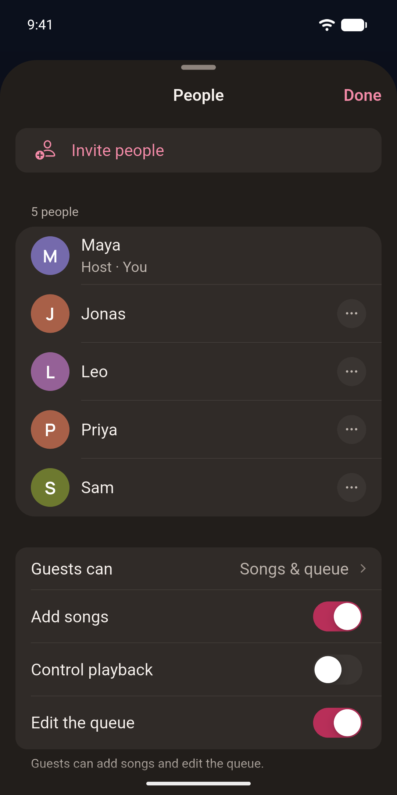
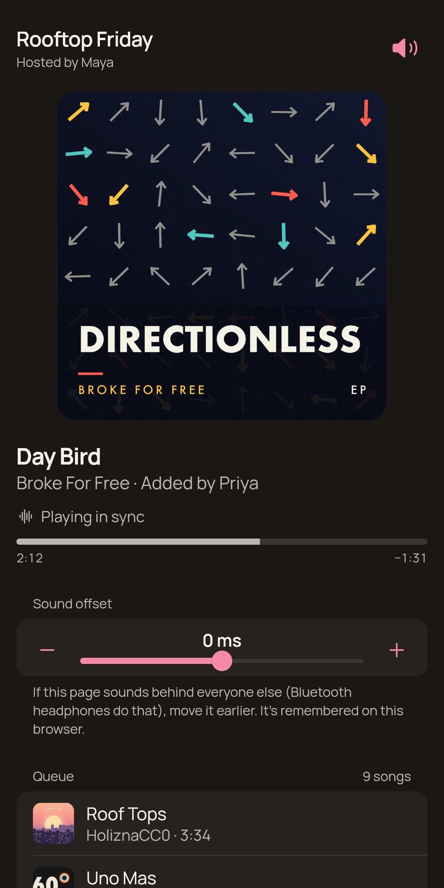
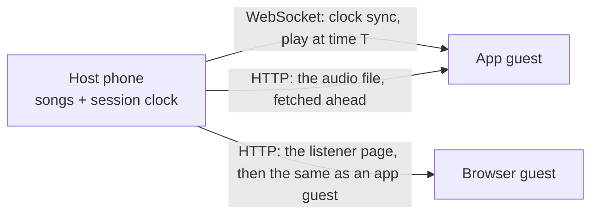

<p align="center">
  
</p>

<h1 align="center">LocalJam</h1>

<p align="center">
  One phone plays. Everyone nearby hears it in sync, in their own headphones.<br>
  No internet, no accounts.
</p>

<p align="center">
  <a href="https://play.google.com/store/apps/details?id=dev.bimsina.localjam"></a>
  <a href="https://github.com/bimsina/localjam/releases/latest"></a>
  <a href="LICENSE"></a>
  <a href="https://localjam.bimsina.dev"></a>
</p>

<table align="center">
  <tr>
    <td></td>
    <td></td>
    <td></td>
    <td></td>
    <td></td>
  </tr>
</table>


LocalJam is for the moment a few people want to hear the same thing: a car,
a kitchen, a trip, a room full of headphones. One person starts a jam and
plays music from their own files. Everyone on the same Wi-Fi or hotspot
hears the same song at the same moment, on their own device.

Friends join from **Nearby**, a **QR code** or a **link**. Someone without
the app scans the QR code and listens in their browser. Nothing leaves the
room.

## Why

LocalJam started on a trip to Pokhara. A group of us wanted the same music
in everyone's earphones, and there was no way to do it. iPhones can share
audio, but only with AirPods or Beats, and only two pairs. Samsung's Dual
Audio stops at two Bluetooth devices. Nothing works across every phone and
every pair of headphones.

LocalJam does not send audio over Bluetooth at all. Each person listens on
their own device, with whatever headphones they already have, and the
devices keep each other in time.

## Features

- **Join in seconds.** Nearby, QR code or link. Every device gets a friendly
  name ("Silky Puffin") you can change.
- **No app needed to listen.** The host serves a listener page on the local
  network, so a guest can join from any browser.
- **A shared queue.** Add songs from your files or the phone's music
  library, reorder, skip. Every song shows who added it.
- **You decide who does what.** Three room styles, **Open**, **Jam** and
  **Listen-only**, plus co-hosts, per-person permissions and kick.
- **Plays in the background**, with lock-screen and notification controls.
- **Sync nudge** for headphones that add their own delay, such as some
  Bluetooth sets.
- **Jam history** on your device: what played, who added it, who was there.
  Host it again in one tap.
- **Private.** No accounts, no analytics, no ads, no server.
  ([`PRIVACY.md`](PRIVACY.md))

## Download

| | |
| --- | --- |
| **Android** | [Google Play](https://play.google.com/store/apps/details?id=dev.bimsina.localjam) · [APK](https://github.com/bimsina/localjam/releases/latest) |
| **macOS** | [`.zip`](https://github.com/bimsina/localjam/releases/latest). The first time, right-click the app and choose **Open**. |
| **Any browser** | Scan the host's QR code. Listen only, nothing to install. |

The Play build and the GitHub APK are signed with different keys, so one
cannot update the other: uninstall one before installing the other. iOS,
Linux and Windows [build from source](#building-from-source).

## Getting started

1. Put everyone on the same Wi-Fi, or have one phone turn on its hotspot and
   the others join it.
2. On one phone, start a jam and add songs.
3. Everyone else opens LocalJam and taps the jam under Nearby, or scans the
   host's QR code.

| Problem | Try |
| --- | --- |
| The jam does not show under Nearby | Join with the QR code or link. Hotspots, guest Wi-Fi and many office networks block Nearby discovery. |
| Nobody can connect | The network keeps devices apart ("client isolation", common on guest and public Wi-Fi). Use a home network or a phone hotspot. |
| A guest sounds late | Use the sync nudge. Bluetooth headphones add some delay. |
| Hosting on a desktop | Allow LocalJam through the firewall on private networks. |

A jam is open to anyone on the same network while Nearby is on. Turn Nearby
off to admit people only by QR code or link, and use networks you trust.

## How it works



The host phone runs a small server on the local network. Guests download
each song ahead of time and synchronise their clocks with the host's. The
host then says "position P at time T", and every device starts its own
audio at that instant. Small drift is corrected with inaudible speed
changes, not jumps.

The wire protocol and its security model are in [`PROTOCOL.md`](PROTOCOL.md).

## Building from source

You need **Flutter 3.50.0**. Android also needs the Android SDK, iOS and
macOS need Xcode, and Linux needs
`clang cmake ninja-build pkg-config libgtk-3-dev`.

```sh
git clone https://github.com/bimsina/localjam.git
cd localjam
tool/build_web_guest.sh        # optional: the browser listener page

cd apps/localjam_app
flutter run                    # on whatever device is attached
flutter build apk --debug      # or: macos, ios, linux, windows
```

No second phone? The headless CLI can stand in as a host or a guest:

```sh
cd apps/localjam_cli
dart run bin/localjam.dart host <audio files...>     # prints a join link
dart run bin/localjam.dart join "<join link>"
```

Every package has offline tests (`dart test` or `flutter test` in its
directory). More in [`apps/localjam_app/README.md`](apps/localjam_app/README.md)
(per-platform notes), [`DEVICE_TESTING.md`](DEVICE_TESTING.md) (what has
been verified on which hardware) and
[`docs/release/ANDROID_RELEASE.md`](docs/release/ANDROID_RELEASE.md)
(signing and releasing; releases are cut with
[`tool/release.sh`](tool/release.sh)).

```
packages/
  localjam_core        pure Dart: messages, codec, clock sync, permissions
  localjam_net         host server (WebSocket + HTTP), guest client, mDNS
  localjam_audio       Flutter plugin: sample-accurate native playback
  localjam_client      the engine the apps depend on
apps/
  localjam_app         the Flutter app
  localjam_web         the browser listener page
  localjam_cli         headless host and guest for testing
```

## Contributing

Bug reports, test results from real devices and patches are welcome. Start
with [`CONTRIBUTING.md`](CONTRIBUTING.md); changes are tracked in
[`CHANGELOG.md`](CHANGELOG.md). Report vulnerabilities privately as
described in [`SECURITY.md`](SECURITY.md).

## Licence and credits

[MIT](LICENSE) © Bibek Timsina. Bundled third-party code and fonts keep
their own licences; the app lists them all under Settings → Licenses. QR
scanning on Android uses Google's ML Kit, on the device, under Google's
terms.

Only share music you have the right to share.

<details>
<summary>Music in the screenshots</summary>

The store screenshots and launch video use freely licensed music. Cover art is
original artwork made for the demo.

- HoliznaCC0 — *Roof Tops*, *Summer Felt Longer Then*, *Faded in the Sunlight* (Summer Air (Lo-fi), 2026) — [CC0 1.0](https://creativecommons.org/publicdomain/zero/1.0/) — [1](https://freemusicarchive.org/music/holiznacc0/summer-air-lo-fi/roof-tops/), [2](https://freemusicarchive.org/music/holiznacc0/summer-air-lo-fi/summer-felt-longer-then/), [3](https://freemusicarchive.org/music/holiznacc0/summer-air-lo-fi/faded-in-the-sunlight/)
- Broke For Free — *Night Owl*, *Day Bird*, *Mell's Parade* (Directionless EP, 2011) — [CC BY 3.0](https://creativecommons.org/licenses/by/3.0/) — [1](https://freemusicarchive.org/music/Broke_For_Free/Directionless_EP/Broke_For_Free_-_Directionless_EP_-_01_Night_Owl/), [2](https://freemusicarchive.org/music/Broke_For_Free/Directionless_EP/Broke_For_Free_-_Directionless_EP_-_03_Day_Bird/), [3](https://freemusicarchive.org/music/Broke_For_Free/Directionless_EP/Broke_For_Free_-_Directionless_EP_-_05_Mells_Parade/)
- Loyalty Freak Music — *Everyone*, *Chillin with a drink at the club*, *Traveling in your mind* (TO CHILL AND STAY AWAKE, 2017) — [CC0 1.0](https://creativecommons.org/publicdomain/zero/1.0/) — [1](https://freemusicarchive.org/music/Loyalty_Freak_Music/TO_CHILL_AND_STAY_AWAKE/Loyalty_Freak_Music_-_TO_CHILL_AND_STAY_AWAKE_-_02_Everyone/), [2](https://freemusicarchive.org/music/Loyalty_Freak_Music/TO_CHILL_AND_STAY_AWAKE/Loyalty_Freak_Music_-_TO_CHILL_AND_STAY_AWAKE_-_03_Chillin_with_a_drink_at_the_club/), [3](https://freemusicarchive.org/music/Loyalty_Freak_Music/TO_CHILL_AND_STAY_AWAKE/Loyalty_Freak_Music_-_TO_CHILL_AND_STAY_AWAKE_-_05_Traveling_in_your_mind/)
- Steve Combs — *Suburban Ghosts*, *I'm Looking For The Good In You*, *Where Else But Here?*, *Otherwise Very* (Suburban Ghosts, 2016) — [CC BY 4.0](https://creativecommons.org/licenses/by/4.0/) — [1](https://freemusicarchive.org/music/Steve_Combs/Suburban_Ghosts/Steve_Combs_-_Suburban_Ghosts_-_01_Suburban_Ghosts/), [2](https://freemusicarchive.org/music/Steve_Combs/Suburban_Ghosts/Steve_Combs_-_Suburban_Ghosts_-_02_Im_Looking_For_The_Good_In_You/), [3](https://freemusicarchive.org/music/Steve_Combs/Suburban_Ghosts/Steve_Combs_-_Suburban_Ghosts_-_04_Where_Else_But_Here-/), [4](https://freemusicarchive.org/music/Steve_Combs/Suburban_Ghosts/Steve_Combs_-_Suburban_Ghosts_-_06_Otherwise_Very/)
- Airmen of Note (U.S. Air Force Band) — *さくら (Sakura)*, *아리랑 (Arirang)* (Global Reach, 2018); *Uno Mas*, *Blues for Mundy* (60 Years of the Airmen of Note, 2011) — [Public domain (US federal government work)](https://commons.wikimedia.org/wiki/Template:PD-USGov-Military-Air_Force) — [1](https://commons.wikimedia.org/wiki/File:Sakura_-_Airmen_of_Note_-_United_States_Air_Force_Band.mp3), [2](https://commons.wikimedia.org/wiki/File:Arirang_-_Airmen_of_Note_-_United_States_Air_Force_Band.mp3), [3](https://commons.wikimedia.org/wiki/File:Uno_Mas_-_Airmen_of_Note_-_United_States_Air_Force_Band.mp3), [4](https://commons.wikimedia.org/wiki/File:Blues_for_Mundy_-_Airmen_of_Note_-_United_States_Air_Force_Band.mp3)

*Sakura* and *Arirang* are shortened with a fade-out. Recordings by the U.S.
Air Force Band are US federal government works; no endorsement is implied.

</details>
